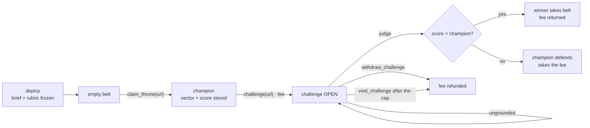

# Gauntlet

**An open contest with a frozen rubric, a belt that changes hands, and no owner.**

Anyone can put a public page forward. A committee of validators scores it against
a rubric that was fixed at deployment and that nobody can edit — not the
deployer, not a governor, not the winner. The first entry takes the belt. After
that, every challenger pays a fee, names one page, and wins only by passing
**strictly more criteria** than the champion's stored score. Lose or tie, and the
fee is the champion's prize.

No owner. No judges to appoint. No editorial committee deciding who is allowed
to compete.

## Why it is different

Most "AI judges" contracts ask a model to compare two pieces of writing and pick
a winner. That is the hardest thing to make consensus-safe: two honest models
will disagree, and the contract has no way to tell a disagreement from a mistake.

Gauntlet removes the comparison. The champion's pass/fail vector is **stored at
crowning time and frozen**. A challenger is scored once, against the same rubric,
and the contract compares two integers. Consensus only has to agree on a short
string of bits — `101` versus `111` — not on taste.

That gives the contract three properties that are unusual together:

- **No owner at all.** The brief and the rubric live in the constructor; there is
  no setter, no pause, no upgrade path, nobody to bribe.
- **A bar that cannot move.** The target is the champion's score, so a challenge
  cannot be "re-judged" against a different standard halfway through.
- **Money that always has an exit.** A challenge that cannot be grounded is
  refunded, never confiscated: by the challenger at any time, or by anyone once
  the attempts are spent or the timeout passes.

## Live on GenLayer Studio

`deployment.json` is the single source of truth for the deployed address: the
**Deploy Contract** workflow deploys the contest once with its frozen rubric,
writes the file, and commits it back to `main`. Until it exists, nothing is
deployed.

| | |
|---|---|
| **Contract** | [`0xDeF418E6b0D4002E6D493B7B4183cDF626454B2C`](https://explorer-studio.genlayer.com/address/0xDeF418E6b0D4002E6D493B7B4183cDF626454B2C) |
| **Network** | GenLayer Studio — chainId `61999` (`0xf22f`), test GEN only |
| **Evidence** | [Actions](https://github.com/weels007/genlayer-gauntlet/actions) — the direct suite, the Studio suite, and every deployment |

## Lifecycle



## How a score is produced

| Step | What happens |
|---|---|
| **Fetch** | The challenger's frozen URL is rendered as text inside the non-deterministic block, capped at `MAX_ENTRY_CHARS`. |
| **Score** | The model returns one mark per criterion (`1`/`0`), plus a verbatim quote and a short reason. |
| **Ground** | The quote must be a substring of the fetched page after folding to letters and digits. An ungrounded quote scores nothing. |
| **Consensus** | Validators re-run the fetch and the scoring and must produce the same vector exactly. The score is derived from the vector, never sent by the model. |
| **Settle** | `score > champion.score` takes the belt and returns the fee; anything else defends it. |

The vector is the whole decision: an empty vector means "not decided", the
challenge stays open, and an attempt is booked against it. Three attempts, or
seven days, and anyone may void the challenge and refund the fee.

### Error taxonomy

| Tag | Meaning | Consensus behaviour |
|---|---|---|
| `[EXPECTED]` | bad input, wrong caller, no champion, a challenge already open | deterministic, must match |
| `[EXTERNAL]` | the entry page is empty | deterministic, recorded |
| `[TRANSIENT]` | network / 5xx | both transient means agreement, retry |
| `[LLM_ERROR]` | malformed vector, ungrounded quote | always disagrees → new leader |

## Money rules

The only value that enters is a challenge fee, and the only places it can go are
the challenger (won, withdrew, or the challenge was voided) and the champion
(defended).

- **`challenge` never reverts once value is attached.** A refused target — no
  champion yet, a challenge already open, an invalid URL, the challenge cap —
  becomes a **credit** recorded against the sender and withdrawable with
  `withdraw_credit`.
- **A win returns the fee** and hands over the belt, so winning costs nothing.
- **A loss or a tie pays the fee to the champion.** Beating the bar is the only
  way to take anything back.
- **A judgement nobody can ground moves nothing.** The challenge stays open; the
  fee can be withdrawn by the challenger, or voided by anyone after the attempt
  cap or the timeout, and always returns to the challenger.
- **The ledger is updated first and the transfer last**, so a failed transfer
  rolls both back together.

Invariant: `total_in == total_out + locked_total`, credits included.

## Contract API

**Write**

| Method | Who | Purpose |
|---|---|---|
| `claim_throne(url)` | anyone, while the belt is empty | crown the first champion with one scored page |
| `challenge(url)` · payable | anyone | put a fee behind one entry against the stored score |
| `judge(challenge_id)` | anyone | score the open challenge and settle the fee |
| `withdraw_challenge(challenge_id)` | the challenger | take the fee back before it is decided |
| `void_challenge(challenge_id)` | anyone | refund a challenge after the attempt cap or the timeout |
| `withdraw_credit()` | anyone with a credit | take back a fee that arrived for a refused challenge |

**View**

| Method | Returns |
|---|---|
| `get_contest()` | the frozen brief, rubric and criteria count |
| `get_champion()` | the belt: owner, URL, vector, score, quote, digest, since |
| `get_challenge(id)` · `get_challenges()` · `get_open_challenge()` | challenges |
| `get_credit(address)` | a refundable credit |
| `get_ledger()` · `get_balance()` | `total_in`, `total_out`, `locked_total`, real balance |
| `get_summary()` · `get_rules()` | counters, and the bounds the contract enforces |

## Security review

| Risk | How Gauntlet answers it |
|---|---|
| Stored text steers a later decision without consensus | The only consequential field is the pass/fail vector, and it is the only field compared. `quote`, `reason` and the digest are descriptive and no later call reads them. |
| Validator checks the leader's formatting, not the substance | Validators re-run the fetch and the scoring and must produce the identical vector. A run that cannot verify returns a rejection. |
| Evidence URL handed to the model, never fetched | The contract renders the entry itself, caps it, and grounds the quote in exactly that text. |
| Someone can move the goalposts | The brief and rubric are constructor arguments with no setter, and the belt is defended against a **stored** score, not against a fresh reading of the champion's page. |
| Funds locked forever | `withdraw_challenge` (by the challenger) and `void_challenge` (by anyone, after three attempts or seven days) always refund the fee to the challenger. |
| Any account moves someone else's money | Only the challenger can withdraw their own challenge; `void_challenge` and `judge` are open by design but always pay the stored party. |
| Caller text manipulates the judge | The entry is framed as untrusted data, the rubric is frozen, and an entry that tries to instruct the judge fails the criteria it does not otherwise satisfy. |
| SSRF through the entry URL | `https` only, no IP literal in any spelling, no single-label host, no metadata aliases, alphabetic TLD required. |
| Integer and division hazards | No floats and no true division: the score is `vector.count("1")`. |
| Unbounded work | 2 000 challenges, one open at a time, three judgement attempts each, capped strings, O(1) summary. |

Residual risks, stated plainly:

- A rubric is a judgement, not a proof. Criteria that read as facts ("the page
  shows an install command") are stable; criteria that read as taste are not, and
  will produce `UNRESOLVED` runs rather than wrong winners.
- The champion's page can change after crowning. The belt is defended against the
  **stored** vector, and the stored URL and quote stay public so a reader can see
  what was judged.
- The reporter fetches only the URL it was given; a public URL that redirects to
  a private one is a property of the validator's HTTP client, not of this code.

## Testing

| Suite | What it covers | Run |
|---|---|---|
| **Direct** | the frozen rubric, crowning, every challenge path, the score comparison, refunds, consensus on the vector | `pytest tests/direct -v` |
| **Studio** | the deployed contract: a live crowning, a challenge scored by the committee, the fee landing where the rubric says, and the refusals | `pytest tests/integration -v -s` |
| **End to end** | the deployed contract, the money paths around the judgement: a second challenge as a credit, both refunds, the void guard, a stranger reaching for another account's fee, a challenger that cannot clear the bar, and an entry nobody can ground driven to the attempt cap and voided by the other account | `pytest tests/e2e -v -s` |

Every assertion in the Studio suite is a delta — a count, a balance, a ledger
total — so it can be re-run against the same contest without an earlier run
leaking into it.

`testdata/ungroundable.txt` is the fixture behind the void case: a page whose
whole text folds to nineteen letters, one short of the twenty a quote needs to
ground. Every quote taken from it is a substring of that fold, so no judgement
against it can settle — on any run, for any model. The committee cannot decide it,
the attempts run out, and the fee is refunded. That is an undecided judgement on
demand, instead of waiting out the seven-day timeout.

A tie needs no fixture: the bar is the champion's stored score, so a challenger
judged against the champion's own page is decided by arithmetic whenever that
score is the rubric's maximum. Nothing can pass more criteria than all of them.

## Quick start

```bash
pip install -r requirements.txt

genvm-lint check contracts/Gauntlet.py   # forbidden imports, storage, nondet misuse
pytest tests/direct -v                  # the whole suite, in memory, milliseconds
pytest tests/integration -v -s          # the deployed contest, live
pytest tests/e2e -v -s                  # the deployed contest's money paths

python scripts/deploy.py                # deploy once, record deployment.json
```

The direct suite mocks the page and the model; the clock and every money path are
exercised in memory, including a challenge that wins, one that defends, one the
committee cannot ground, and one that is voided after the attempt cap.

The live suites sign with throwaway Studio accounts that the repository keeps in
Actions secrets — one to drive the contest, and a second for the cases that need
a genuine stranger, since only the caller may take their own fee back — so no key
material is committed.

## Layout

```text
contracts/Gauntlet.py            the contest
tests/direct/                    crowning, challenges, money, consensus
tests/integration/               the deployed contest, live
tests/e2e/                       the deployed contest's money paths
testdata/ungroundable.txt        a page no quote can be grounded in
scripts/deploy.py                deploys once with the rubric, records deployment.json
scripts/wallet.py                keystore from tests/ or a repository secret
deployment.json                  the deployed address (written by the workflow)
.github/workflows/ci.yml         genvm-lint + the direct suite
.github/workflows/integration.yml  the Studio suite
.github/workflows/e2e.yml        the money paths on the deployed contest
.github/workflows/deploy-contract.yml  one deploy, address committed back
```

## License

[MIT](LICENSE).
